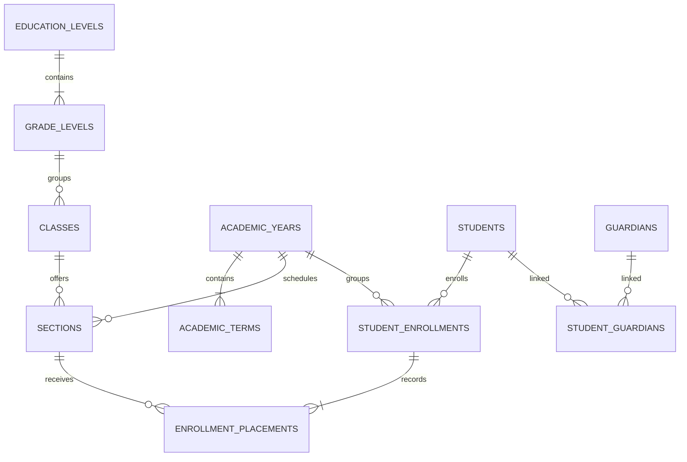
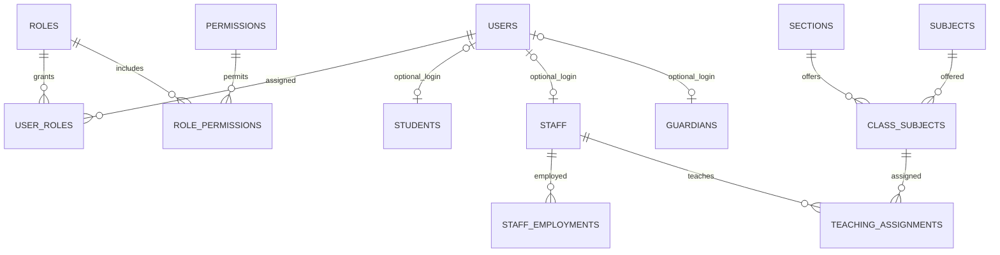
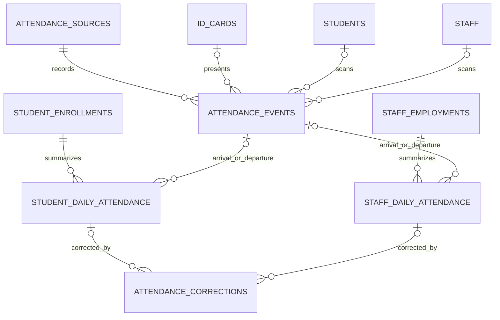
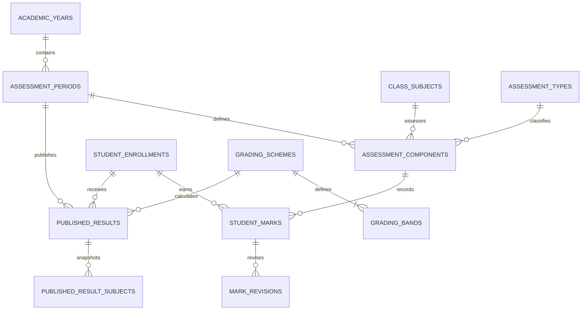
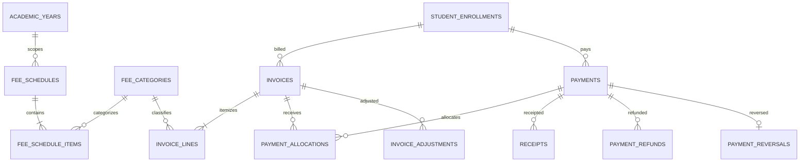

# EduKit database design proposal

**Status:** Review proposal only — not an approved schema  
**Scope:** Domain discovery and reviewable MariaDB design; no SQL, migrations, or application implementation are included.

## 1. Executive summary

EduKit needs a durable school record spanning academic structure, student and staff histories, identity and authorization, attendance evidence, configurable assessment, and auditable finance. This proposal organizes those records into explicit relational modules using MariaDB/InnoDB, `utf8mb4`, surrogate internal keys, foreign keys, unique business identifiers, and append-only evidence or transaction history where corrections must not erase what happened.

The proposed model distinguishes:

- Stable people and login accounts from academic-year enrollment, class placement, employment, and teaching assignment.
- Raw attendance scans from derived daily attendance.
- Assessment configuration from marks, calculated results, and published result snapshots.
- Invoices, payment receipts, allocations, and corrections/refunds as separate financial facts.
- Opaque card credentials from the identity printed on or encoded by a card.

No school-specific rules are treated as settled. The schema should be implemented only after the priority questions in section 14 are answered. Proposed tables, names, and cardinalities below are a basis for review, not a claim that the school has approved them.

## 2. Scope, inspected foundation, and assumptions

### 2.1 Confirmed requirements

- EduKit is a combined school serving multiple educational levels; exact levels and terminology are unknown.
- The application is a custom PHP MVC system using Composer, PDO, MariaDB, Apache/XAMPP for development, Tailwind, and vanilla JavaScript.
- School operations should work on a local server/LAN without routine internet access.
- MariaDB with InnoDB and `utf8mb4` is required.
- Grading must be configurable; finance includes fee structures, invoices, payments, outstanding balances, receipts, adjustments, and reports.
- Attendance needs arrival and departure scans and calculated daily status.
- Student/staff cards and a future local PA/bell system are planned. No PA hardware or schema is in scope here.
- Security, auditability, historical preservation, and versioned migrations are required.

### 2.2 Repository findings

Inspection of the README, architecture notes, Composer configuration, config, bootstrap, PDO connection factory, test configuration, and database directory found:

- There is no established SQL table/column naming convention or schema.
- `database/migrations/` and `database/seeders/` exist only as empty placeholders. There is no migration runner, migration-history table, SQL schema, or repository/model layer.
- The PDO factory expects environment-provided host, port, database, username, and password; it uses `utf8mb4`, exception mode, associative fetches, and disables emulated prepares. It is lazy and not yet used by domain services.
- Wiring is explicit through a small container; Composer PSR-4 maps `EduKit\` to `app/`.
- Tests use PHPUnit. No domain behavior or database integration tests exist.
- Existing application settings include a process timezone default of UTC, but this is not confirmation of the school's timezone. No currency or academic-period conventions exist.
- No conflicting schema assumptions were found. The starter environment's default database name is configuration, not a naming convention.

Credential files were not read or displayed.

### 2.3 Decision categories

**Confirmed:** Only the requirements in section 2.1 and the repository findings above.

**Recommended, awaiting approval:** Naming conventions and proposed relationships in this document; immutable raw scans and posted financial facts; UTC instants plus school-local calendar dates; opaque hashed card tokens; separate, explicit foreign keys instead of polymorphic owners.

**Unknown, requiring school confirmation:** Education levels, academic calendar, student/staff identifiers, operational policies, currency, timezone, permissions, retention, reports, and migration/import source data. Open questions are prioritized in section 14.

## 3. Proposed module and table inventory

The inventory below lists **all proposed tables** in this proposal. Columns are key columns, not an exhaustive field-by-field DDL specification. Exact lengths, enums/lookups, nullability, delete rules, and constraints must be confirmed during schema review. Every table uses `id BIGINT UNSIGNED` as its primary key unless a later reviewed exception is documented.

### 3.1 School and academic structure

| Table | Purpose and key columns | Foreign keys | Important unique constraints and indexes |
|---|---|---|---|
| `school_profiles` | The single operating school's name, official identifiers, contact/address and branding metadata. | None. | Unique non-null official identifier(s), if supplied; index display/legal name only if searched. |
| `school_settings` | School-specific keyed settings such as the selected timezone or active academic-year pointer. Columns: `setting_key`, typed value representation, description, secret flag only if genuinely needed. | Optional `updated_by_user_id` → `users.id` (set null). | Unique `setting_key`. Do not store credentials in this table. |
| `academic_years` | Named academic-year intervals and lifecycle state. Columns: `code`, `name`, `starts_on`, `ends_on`, `status`. | None. | Unique `code`; index `(starts_on, ends_on)` for overlap validation. |
| `academic_terms` | Terms/semesters explicitly belonging to one academic year. Columns: `academic_year_id`, `code`, `name`, date interval, sequence, status. | `academic_year_id` → `academic_years.id` (restrict). | Unique `(academic_year_id, code)` and `(academic_year_id, sequence)`; index `(academic_year_id, starts_on, ends_on)`. |
| `education_levels` | Configurable bands (e.g. confirmed local equivalents of KG/primary/JHS/SHS). Columns: `code`, `name`, sequence, active flag. | None. | Unique `code`; index `(sequence, active)`. |
| `grade_levels` | Ordered grades/year groups belonging to an education level. Columns: `education_level_id`, `code`, `name`, sequence. | `education_level_id` → `education_levels.id` (restrict). | Unique `(education_level_id, code)` and `(education_level_id, sequence)`. |
| `classes` | A named cohort/class grouping derived from a grade, optionally reused as a template across years. It is not itself a year-specific placement. Columns: `grade_level_id`, `code`, `name`. | `grade_level_id` → `grade_levels.id` (restrict). | Unique `(grade_level_id, code)`; index `grade_level_id`. Confirm whether this template table is needed versus year-specific cohorts only. |
| `sections` | Named stream/section for a class in a particular academic year. Columns: `class_id`, `academic_year_id`, `code`, `name`, optional `classroom_id`. | `class_id` → `classes.id`; `academic_year_id` → `academic_years.id`; optional `classroom_id` → `classrooms.id`; all restrict. | Unique `(class_id, academic_year_id, code)`; indexes `(academic_year_id, class_id)` and `classroom_id`. |
| `classrooms` | Physical room inventory. Columns: `code`, `name`, optional capacity/location. | None. | Unique `code`; index `name`. |
| `subjects` | Subject catalogue. Columns: `code`, `name`, optional description and active flag. | None. | Unique `code`; index `(active, name)`. |
| `class_subjects` | Subject offerings within a year-specific section, including optional grading/lesson configuration. | `section_id` → `sections.id`; `subject_id` → `subjects.id`; `academic_term_id` nullable → `academic_terms.id`; restrict. | Unique `(section_id, subject_id, academic_term_id)` needs a non-null normalized offering/term strategy before DDL; index `(subject_id, section_id)`. |

**Class versus section:** A grade level represents an educational step. `classes` represents a reusable named class/cohort if the school uses one. `sections` identifies a specific stream for a class and academic year. A student's actual historical placement belongs in enrollment placement records, not in a mutable `students.current_class_id`.

### 3.2 Users, authentication, authorization, and audit

| Table | Purpose and key columns | Foreign keys | Important unique constraints and indexes |
|---|---|---|---|
| `users` | Login identity only. Columns: `username_normalized`, display username, `password_hash`, optional email, status, `password_changed_at`, `last_login_at`, created/updated timestamps. | None. | Unique `username_normalized`; unique nullable normalized email only if email login is approved; index `(status, id)`. |
| `roles` | Named assignable authorization roles. Columns: `code`, `name`, description, active flag. | None. | Unique `code`. |
| `permissions` | Stable permission catalogue (e.g. `students.read`). Columns: `code`, description. | None. | Unique `code`. |
| `user_roles` | Many-to-many user-role grants, with optional effective interval and grantor. | `user_id` → `users.id`, `role_id` → `roles.id` (cascade on link deletion); optional `granted_by_user_id` → `users.id` (set null). | Unique `(user_id, role_id)` for one current grant; index `(role_id, user_id)`. Historical grant/revoke audit is retained in `audit_logs`, not by accumulating duplicate links. |
| `role_permissions` | Many-to-many role-permission grants. | `role_id` → `roles.id`, `permission_id` → `permissions.id` (cascade on link deletion). | Unique `(role_id, permission_id)`; reverse index `(permission_id, role_id)`. |
| `audit_logs` | Append-only record of sensitive actions, actor, time, action, explicit entity type/key, outcome, reason, and carefully minimized before/after metadata. This is an audit event, not a general polymorphic business FK. | Nullable `actor_user_id` → `users.id` (set null); never cascade-delete audit history. | Index `(occurred_at)`, `(actor_user_id, occurred_at)`, `(entity_type, entity_id, occurred_at)`, `(action, occurred_at)`. Entity reference is intentionally not an FK because one audit log spans explicit domain tables; identifiers are internal and access-controlled. |

Users are not student, staff, or guardian rows. Login accounts are provisioned only when approved; use an explicit one-to-one relationship from a person record to `users` if that person needs access. Do not assume every student or guardian logs in.

### 3.3 Admissions, students, guardians, and enrollment history

| Table | Purpose and key columns | Foreign keys | Important unique constraints and indexes |
|---|---|---|---|
| `students` | Stable student identity/profile independent of yearly placement. Columns: `student_number`, legal/preferred names, date of birth if collected, status, optional `user_id`. | Optional `user_id` → `users.id` (unique, set null). | Unique `student_number`; unique nullable `user_id`; indexes `(status, student_number)` and normalized search name. |
| `admissions` | Application/admission episodes, including applicants not yet enrolled. Columns: `student_id` nullable until accepted/created, application number, applied date, decision/status, decision date, source. | Nullable `student_id` → `students.id` (restrict or set null only if anonymization policy allows); optional `decided_by_user_id` → `users.id` (set null). | Unique `application_number`; index `(status, applied_on)` and `(student_id, applied_on)`. Confirm whether an applicant is created as a student before acceptance. |
| `guardians` | Stable guardian/contact identity, separate from account access. Columns: names, contact fields, address and status as approved. | Optional `user_id` → `users.id` (unique, set null). | Unique nullable `user_id`; indexes on normalized phone/email where search policy permits. Do not assume contact fields are globally unique. |
| `student_guardians` | Student↔guardian relationship. Columns: `student_id`, `guardian_id`, relationship type, primary-contact flag, emergency/contact permissions, effective interval. | `student_id` → `students.id`, `guardian_id` → `guardians.id` (restrict; lifecycle closure rather than deletion). | Unique `(student_id, guardian_id)` for one current relationship; indexes `(guardian_id, student_id)` and `(student_id, is_primary_contact)`. Enforce one primary guardian per student using transactional application logic unless a supported indexed representation is approved. |
| `student_enrollments` | One student's admission/enrollment in one academic year, including year status, start/end dates, entry/exit reason. | `student_id` → `students.id`, `academic_year_id` → `academic_years.id`, optional `admission_id` → `admissions.id`; restrict. | Unique `(student_id, academic_year_id)` if one enrollment per student/year is confirmed; indexes `(academic_year_id, status)` and `(student_id, starts_on)`. |
| `enrollment_placements` | Ordered, effective-dated class/section placement history within an enrollment; promotion or movement appends a new interval rather than overwriting the old one. Columns: `student_enrollment_id`, `section_id`, `starts_on`, nullable `ends_on`, reason, recorded by. | `student_enrollment_id` → `student_enrollments.id`; `section_id` → `sections.id`; optional `recorded_by_user_id` → `users.id`; restrict/set null as appropriate. | Index `(student_enrollment_id, starts_on)`, `(section_id, starts_on)`; transactional rule preventing overlapping active placements per enrollment. |
| `student_documents` | Student document metadata (type, protected storage key, original filename, MIME/size/hash, uploaded time, retention/deletion state). File bytes remain outside web root. | `student_id` → `students.id`; optional uploader → `users.id`; restrict/set null. | Unique opaque `storage_key`; index `(student_id, document_type, created_at)`. Never put file paths or personal data into public URLs. |

### 3.4 Staff and teaching assignments

| Table | Purpose and key columns | Foreign keys | Important unique constraints and indexes |
|---|---|---|---|
| `departments` | Optional school departments. Columns: `code`, `name`, active flag. | None. | Unique `code`. Include only if departments are used. |
| `staff` | Stable staff identity/profile independent of employment periods and user access. Columns: `staff_number`, names, contact fields, status, optional `user_id`. | Optional `user_id` → `users.id` (unique, set null). | Unique `staff_number`; unique nullable `user_id`; indexes `(status, staff_number)` and normalized search name. |
| `staff_employments` | Employment/contract episodes and status/history. Columns: `staff_id`, optional `department_id`, employment type, starts/ends, status. | `staff_id` → `staff.id`; optional `department_id` → `departments.id`; restrict. | Index `(staff_id, starts_on)` and `(department_id, status)`. Multiple episodes are allowed; overlap policy requires confirmation. |
| `teaching_assignments` | Teacher to a year-specific section and subject offering for a period. Columns: `staff_id`, `class_subject_id`, optional term/date interval, role. | `staff_id` → `staff.id`; `class_subject_id` → `class_subjects.id`; optional term → `academic_terms.id`; restrict. | Unique appropriate assignment key after deciding team-teaching/assistant roles; indexes `(staff_id, academic_term_id)`, `(class_subject_id, staff_id)`. |

### 3.5 ID cards and attendance

| Table | Purpose and key columns | Foreign keys | Important unique constraints and indexes |
|---|---|---|---|
| `id_cards` | Card lifecycle for students or staff. Columns: `student_id` nullable, `staff_id` nullable, `token_hash BINARY(32)`, issue/expiry/revocation times, reason, status. Exactly one subject FK must be set. | Nullable `student_id` → `students.id`; nullable `staff_id` → `staff.id`; optional issuer/revoker → `users.id`; restrict/set null on actor only. | Unique `token_hash`; index `(student_id, status)`, `(staff_id, status)`, `(expires_at, revoked_at)`. CHECK exactly one person FK; confirm one active card per person and replacement policy. |
| `attendance_sources` | Configurable source/device registry independent of a scanner vendor: source code/type, location, active flag, secret reference (not secret value), last-seen. | Optional owner/administrator → `users.id` (set null). | Unique `source_code`; index `(active, source_type)`. Device credentials belong in protected environment/secret storage, not rows or logs. |
| `attendance_events` | Immutable raw scan/manual event evidence. Columns: source, optional card, person type and explicit student/staff FKs, occurred-at UTC instant, received-at UTC instant, direction, external event key, idempotency key, accepted/rejected/duplicate disposition, minimal metadata. Exactly one person FK is set for accepted identified events; rejected unknown-token scans may have neither. | `attendance_source_id` → `attendance_sources.id`; optional `id_card_id` → `id_cards.id`; nullable `student_id` → `students.id`; nullable `staff_id` → `staff.id`; all restrict/no cascade. | Unique `(attendance_source_id, external_event_id)` where external ID exists; unique idempotency key; indexes `(student_id, occurred_at)`, `(staff_id, occurred_at)`, `(occurred_at)`, `(attendance_source_id, occurred_at)`. Raw events are append-only. |
| `student_daily_attendance` | Derived daily/session student attendance outcome, arrival/departure event references and calculated status. Columns: enrollment, attendance date in school-local calendar, session key, status, first arrival, last departure, calculation version/time, exception reason. | `student_enrollment_id` → `student_enrollments.id`; optional event FKs → `attendance_events.id`; optional recorder → `users.id`; restrict/set null for actor. | Unique `(student_enrollment_id, attendance_date, session_key)`; indexes `(attendance_date, status)`, `(student_enrollment_id, attendance_date)`, `(first_arrival_event_id)`. |
| `staff_daily_attendance` | Derived staff daily/session attendance if staff attendance is approved. Columns: employment, date, session key, status, first arrival/departure event, calculation version/time. | `staff_employment_id` → `staff_employments.id`; optional event FKs → `attendance_events.id`; optional recorder → `users.id`. | Unique `(staff_employment_id, attendance_date, session_key)`; indexes `(attendance_date, status)`, `(staff_employment_id, attendance_date)`. |
| `attendance_corrections` | Explicit correction/recalculation record: target daily record, before/after values or reasoned delta, actor, approved status, timestamp. Does not edit raw scans. | Target student daily row or staff daily row via two explicit nullable FKs with exactly-one check; actor/approver → `users.id`; restrict/set null for actor. | Index `(student_daily_attendance_id, created_at)`, `(staff_daily_attendance_id, created_at)`, `(actor_user_id, created_at)`. |

**Token handling:** Generate a cryptographically random, opaque token for the card, encode only that token (or a URL-safe representation) in the QR/device payload, and store only a SHA-256 hash in `id_cards`. Compare hashes safely after lookup. Revocation is immediate; replacement inserts a new card record and revokes the old one. Never encode student numbers, names, dates of birth, class, or other personal data in the QR code.

### 3.6 Examinations, grading, and results

| Table | Purpose and key columns | Foreign keys | Important unique constraints and indexes |
|---|---|---|---|
| `assessment_types` | Configurable categories such as classwork or examination. Columns: code, name, active. | None. | Unique `code`. |
| `assessment_periods` | A grading/reporting period within a term/year. Columns: academic year, optional term, code/name, date interval, status. | `academic_year_id` → `academic_years.id`; optional `academic_term_id` → `academic_terms.id`; restrict. | Unique `(academic_year_id, code)`; index `(academic_year_id, starts_on, ends_on)`. |
| `assessment_components` | Configurable component within a period/subject offering, type, maximum mark, optional weight and order. | `assessment_period_id` → `assessment_periods.id`; `class_subject_id` → `class_subjects.id`; `assessment_type_id` → `assessment_types.id`; restrict. | Unique `(class_subject_id, assessment_period_id, code)`; index `(assessment_period_id, class_subject_id)`. Weight semantics and scope await approval. |
| `grading_schemes` | Versioned scheme scoped by level/grade/year/effective period as required. Columns: code, version, scope FKs, status/effective dates, aggregation/rounding/pass configuration. | Optional `education_level_id`, `grade_level_id`, `academic_year_id` → corresponding tables; restrict. | Unique `(code, version)`; indexes on scope and status. Resolve precedence where multiple scopes match. |
| `grading_bands` | Grade boundary and outcome within one scheme. Columns: scheme, code/label, minimum/maximum boundary, sequence, pass indicator/comment. | `grading_scheme_id` → `grading_schemes.id` (cascade only while draft/unreferenced; otherwise restrict). | Unique `(grading_scheme_id, code)` and `(grading_scheme_id, sequence)`; index `(grading_scheme_id, minimum_score)`. Enforce non-overlap/coverage transactionally. |
| `student_marks` | A student's mark/attempt for an assessment component. Columns: component, student enrollment, attempt number, mark/status, entered by/time, publication state. | `assessment_component_id` → `assessment_components.id`; `student_enrollment_id` → `student_enrollments.id`; optional marker → `users.id`; restrict/set null. | Unique `(assessment_component_id, student_enrollment_id, attempt_number)`; indexes `(student_enrollment_id, assessment_component_id)`, `(assessment_component_id, status)`. |
| `mark_revisions` | Append-only correction history for marks: old/new values/status, reason, actor, time. | `student_mark_id` → `student_marks.id`; actor → `users.id` (restrict or set null with actor snapshot). | Index `(student_mark_id, created_at)`, `(actor_user_id, created_at)`. |
| `published_results` | Frozen result publication/version per student enrollment and assessment period, recording scheme/configuration version, totals/outcomes and publication metadata. Recalculate into a new version or explicit correction, not silent overwrite. | `student_enrollment_id` → `student_enrollments.id`; `assessment_period_id` → `assessment_periods.id`; `grading_scheme_id` → `grading_schemes.id`; publisher → `users.id`. | Unique `(student_enrollment_id, assessment_period_id, publication_version)`; index `(assessment_period_id, status, published_at)`. |
| `published_result_subjects` | Frozen per-subject breakdown of a published result, including component aggregates/grade and explanatory status. | `published_result_id` → `published_results.id`; `class_subject_id` → `class_subjects.id`; restrict. | Unique `(published_result_id, class_subject_id)`; index `(class_subject_id, published_result_id)`. |

Marks should retain explicit statuses (e.g. present, absent, exempt, pending) rather than overloading `NULL` or zero. Aggregation policy handles weights, missing marks, resits, rounding, pass rules, ranking, and class/level scope without hardcoded application constants. Exact statuses and policy are not approved.

### 3.7 Full school finance

All amount columns use a reviewed fixed precision, e.g. `DECIMAL(13,2)` only if the chosen currency requires two fractional digits. Currency is explicit on posted financial records, using a school-approved ISO currency code; no currency or precision is assumed here.

| Table | Purpose and key columns | Foreign keys | Important unique constraints and indexes |
|---|---|---|---|
| `fee_categories` | Configurable fee category catalogue. Columns: code, name, active. | None. | Unique `code`. |
| `fee_schedules` | Versioned/effective fee structure for academic period and student/level/grade/section applicability. Columns: code, academic year, optional scope FKs, currency, effective dates, status. | `academic_year_id` → `academic_years.id`; optional level/grade/section FKs → respective tables; restrict. | Unique `(code, version)`; indexes `(academic_year_id, status)`, `(grade_level_id, education_level_id)`. Scope precedence must be approved. |
| `fee_schedule_items` | Fee item/category, amount, due date rule and optional required flag under a schedule. | `fee_schedule_id` → `fee_schedules.id`; `fee_category_id` → `fee_categories.id`; restrict. | Unique `(fee_schedule_id, code)`; index `(fee_category_id, fee_schedule_id)`. |
| `invoices` | Issued student charge document, invoice number, student enrollment, issue/due dates, currency, status, totals snapshot. Posted invoice is not overwritten. | `student_enrollment_id` → `student_enrollments.id`; optional issuer → `users.id`; restrict/set null. | Unique `invoice_number`; indexes `(student_enrollment_id, status, due_on)`, `(status, due_on)`, `(issued_at)`. |
| `invoice_lines` | Immutable issued line description, fee item/category snapshot, quantity/rate/amount and tax/discount data only if policy requires. | `invoice_id` → `invoices.id`; optional `fee_schedule_item_id` → `fee_schedule_items.id`; category FK → `fee_categories.id`; restrict. | Index `(invoice_id, line_number)` and `(fee_category_id, invoice_id)`; unique `(invoice_id, line_number)`. |
| `payments` | Posted receipt of funds, payment reference, payer, amount, currency, method, received time, status and recording user. Posted facts are never deleted. | Optional `student_enrollment_id` → `student_enrollments.id` (restrict); `recorded_by_user_id` → `users.id` (set null only if actor attribution is retained in the audit record). | Unique `payment_reference`; indexes `(student_enrollment_id, received_at)`, `(status, received_at)`. |
| `payment_allocations` | Amount from a payment applied to an invoice. Enables one payment to cover several invoices and partial invoice settlement. | `payment_id` → `payments.id`; `invoice_id` → `invoices.id`; restrict. | Unique `(payment_id, invoice_id)` unless multiple independently traceable allocations are needed; index `(invoice_id, payment_id)`. In a transaction enforce allocations ≤ payment amount and invoice net due. |
| `receipts` | Numbered receipt issuance/reissuance metadata linked to a payment, including issue/void/replacement information. A correction does not erase an issued receipt. | `payment_id` → `payments.id`; optional issuer/voider → `users.id`. | Unique `receipt_number`; index `(payment_id, issued_at)`. Confirm whether one payment can have multiple receipt copies or replacement receipts. |
| `invoice_adjustments` | Approved discounts, waivers, penalties, credit notes or corrections affecting an invoice, with positive amount, reason, type and approval/posting state. | `invoice_id` → `invoices.id`; optional approver/creator → `users.id`; restrict/set null for actor. | Unique adjustment number if issued; indexes `(invoice_id, status, created_at)`, `(adjustment_type, posted_at)`. Reversal is a new linked adjustment, not edit/delete. |
| `payment_refunds` | Funds returned to payer, related to original payment and optionally to invoice allocation, amount/method/reference/status/reason. | `payment_id` → `payments.id`; optional `payment_allocation_id` → `payment_allocations.id`; processor/approver → `users.id`. | Unique refund reference; indexes `(payment_id, status, refunded_at)`, `(payment_allocation_id)`. Enforce cumulative refunds ≤ eligible received amount. |
| `payment_reversals` | Explicit posted reversal/void correction referencing an original payment and reason, actor and date; should be exceptional and immutable. | `payment_id` → `payments.id` (unique if only one full reversal); actor/approver → `users.id`. | Unique reversal per payment where full-only policy applies; index `(reversed_at, status)`. Partial corrections may instead require a separate reviewed transaction model. |

**Balance strategy:** Derive invoice balance from posted lines, posted adjustments, valid allocations, and reversals/refunds using a consistent transactional query. Do not accept a browser-submitted balance. If reporting volume later requires cached balances, define an atomic ledger/materialized projection with reconciliation and rebuild tools; do not make an uncontrolled balance column authoritative.

**Overpayments and allocation:** Permit an unapplied payment remainder only if the school approves credit-on-account behavior. Otherwise validate allocation plus approved unallocated amount against payment amount. Refunds reference the original payment and, where relevant, its allocation. Receipt numbering must be transaction-safe and never recycle voided numbers.

### 3.8 Shared operational infrastructure

| Table | Purpose and key columns | Foreign keys | Important unique constraints and indexes |
|---|---|---|---|
| `backup_runs` | Operational record of backup/restore attempt, start/end, outcome, operator, protected artifact reference and checksum. Never store DB passwords or expose file paths publicly. | Optional operator → `users.id` (set null). | Index `(started_at, status)`, `(operator_user_id, started_at)`. Retention is a policy; artifact files remain protected outside `public/`. |

Notifications are not proposed as tables until communication channels, offline delivery, read state, and retention requirements are known. Likewise, do not add a generic attachment owner table using `owner_type/owner_id`; use explicit owner relationships for each approved document domain. Migration bookkeeping belongs to the future migration runner and is described in section 13, not treated as a school-domain table.

## 4. Key relationships and Mermaid diagrams

### 4.1 Academic structure and enrollment

`student_enrollments` is the student-year registration; `enrollment_placements` records each effective section/class assignment within it. This avoids overwriting a student's prior year or previous class placement.

### 4.2 Authentication, identity, staff and teaching

An account is optional and separate from each person record. A person should not receive multiple accounts implicitly merely by having multiple school roles; role assignments belong to the account.

### 4.3 Raw attendance and daily results

Each event is evidence; daily records are derived and can be rebuilt from accepted scans plus authorized manual corrections. Diagram optional edges reflect the mutually exclusive person/target FKs constrained to exactly one applicable owner.

### 4.4 Assessment and published results

### 4.5 Finance

Posted records are corrected with linked, auditable facts rather than destructive edits. Transactions coordinate payment posting, allocation, receipt issuance, and financial adjustment.

## 5. Student admission, enrollment, and class-promotion lifecycle

1. Record an application in `admissions`; the school must decide whether an applicant receives a `students` row before acceptance.
2. On acceptance, create or link the stable `students` profile and finalize the admission relationship.
3. Create at most the approved number of `student_enrollments` for a student and academic year. The recommended provisional key is one enrollment per student/year.
4. Place the student in a year-specific `sections` row using `enrollment_placements`. Promotion, stream transfer, repeat, or correction closes the prior effective interval and inserts a new placement in a transaction; it never replaces prior history.
5. Transfer/withdrawal/completion updates enrollment lifecycle status and dates with an authorized actor/reason. Do not delete enrollment or placement history.
6. A new academic year creates a new enrollment and placement rather than mutating the previous year's enrollment.

**Unresolved:** Whether a student may have multiple admission episodes or parallel enrollments, exact status lifecycle, mid-year transfer rules, whether a class can have multiple streams, and whether grade/section changes are effective by date or term.

## 6. Attendance scan processing and daily-summary lifecycle

1. The scanner sends an opaque card token, direction, source/device identity, device event ID if available, and event instant. The server authenticates the device independently of student/staff login.
2. Validate source status and token hash. Never log submitted token contents. Resolve a valid, non-revoked card to its person; retain rejected attempts only if the school approves the privacy/retention policy.
3. Insert the raw `attendance_events` row in a transaction. Use `(attendance_source_id, external_event_id)` or a generated idempotency key to ensure retrying the same scan cannot create a second accepted event. A scanner without a stable event ID needs a carefully reviewed deduplication window/key; do not deduplicate solely by person/time in a way that erases legitimate repeat scans.
4. Do not update a previous raw scan when a later scan arrives. Raw events are append-only and hold source, received, event time, direction, card, and identity evidence.
5. Process accepted events for the relevant school-local attendance date/session into the daily summary. Select the applicable arrival/departure according to the approved late/early/multiple-scan rules, preserve the source event FKs, and compute status. Make processing idempotent using the unique enrollment/date/session key.
6. Corrections require an authenticated actor, timestamp, reason, and append-only `attendance_corrections` record. Recalculate the derived summary in the same transaction or enqueue a durable local job; retain before/after values. Manual attendance also records source and actor and never fabricates a scanner event.
7. Reprocessing uses a versioned rule set and does not silently overwrite a manually approved correction. Expose correction conflicts for review.

**Unresolved:** Attendance session (full day vs morning/afternoon), school-day cutoff, arrival/departure status logic, repeated scans, overnight events, manual entry approvals, lateness/early-leave thresholds, staff scope, and retention of rejected scans.

## 7. Configurable grading and result lifecycle

1. Create assessment periods for approved academic intervals and class-subject offerings.
2. Configure components and assessment types, maximum marks, weighting and status handling for the relevant scope.
3. Define a versioned grading scheme with an explicit applicability scope (school, level, grade, year, or another approved key), aggregation/rounding/pass configuration, and ordered grade bands.
4. Enter a student's component mark with an explicit attempt and status. Preserve corrections in `mark_revisions`; restrict edits after publication except through the approved correction path.
5. Calculate totals with the scheme version and rule inputs recorded. Validate component weights, maximum marks, band coverage/non-overlap, missing/exempt/absent behavior, and resit policy.
6. On publication, insert a versioned `published_results` snapshot and subject breakdown. Later correction creates a new publication version or a separately approved correction, retaining the prior published report.
7. Generate report cards from the frozen result snapshot plus student/class/school display data. If historical presentation must be byte-for-byte reproducible, retain a protected rendered-document artifact and checksum; otherwise document which labels remain live.

Different grade levels and years can select distinct scheme versions without code-level grade thresholds. Precedence among overlapping scheme scopes, aggregation and report/ranking choices require approval before enforcing uniqueness.

## 8. Invoice, payment, receipt, refund, and reversal lifecycle

1. Approve/version a fee schedule for an academic period and defined applicability scope. Changes create a new version; issued invoices retain copied descriptions, amounts, currency, and relevant source item references.
2. Issue an invoice with a stable, non-reused invoice number and line snapshots in one transaction. Issued lines are immutable; corrections are a credit/debit adjustment or cancellation/reissue according to policy.
3. Record a received payment as a posted payment with a unique external/internal reference and approved method. Allocate it to one or more invoices through `payment_allocations`, in the same transaction as receipt issuance when a receipt is required.
4. Permit partial payments by leaving the invoice partly unpaid. Permit overpayment/unapplied credit only if the school approves. Validate total allocations against payment value and invoice net due under row locks/transactional checks.
5. Issue a unique-numbered receipt linked to the payment. Voiding/reprinting must retain original receipt number and replacement link/history; numbers are never recycled.
6. Apply discounts, waivers, penalties, scholarships, and corrections as approved `invoice_adjustments` with reason, actor, and effective/posting date. Reversing an adjustment inserts a linked compensating adjustment; do not alter or delete a posted adjustment.
7. Record a refund against the original payment, and optionally its invoice allocation. Enforce cumulative refund limits, retain reference/method/approval, and adjust derived receivable reporting consistently.
8. A full payment reversal references the original payment and reverses its eligible allocations/receipt state with a reason and authorization. A reversal is not deletion. Partial reversals require a separately reviewed policy/model.
9. Derive outstanding balances from posted invoice lines/adjustments and valid allocations/reversals/refunds. Reconcile reports against payment and allocation totals.

No general ledger, tax accounting, cash drawer, bank reconciliation, installment plan, foreign-currency, or double-entry account tables are proposed until the school confirms those requirements.

## 9. Data types, naming, and timestamp conventions

- **Engine/charset:** InnoDB; database, table, and connection use `utf8mb4`. Select and document one MariaDB-supported collation appropriate to the installed version and local language/search needs.
- **Primary keys:** `id BIGINT UNSIGNED AUTO_INCREMENT` on ordinary tables. Link tables may use this same key for consistent audit/FK support plus a unique pair constraint. Never expose sequential IDs as public identifiers.
- **Names:** Lowercase `snake_case` plural table names; lowercase `snake_case` columns. Foreign-key columns use `<singular_table>_id`; unique/index/constraint names use consistent prefixes such as `uq_`, `ix_`, and `fk_`, with names kept within MariaDB identifier limits.
- **Business identifiers:** Separate application-issued student/staff/application/invoice/payment/receipt codes from internal IDs. Define normalization, format, scope, allocation concurrency, and reuse rules before assigning uniqueness.
- **Time:** Use `DATE` for school-local calendar days and effective dates. Store instants in `DATETIME(6)` normalized to UTC, with UTC conversion performed consistently at application boundaries; MariaDB `TIMESTAMP` implicit/session timezone conversion should not be relied upon for audit instants. Store the confirmed IANA school timezone as school configuration for interpreting school days and displaying times. Device time, server receive time, and local attendance date are distinct facts.
- **Money:** Use `DECIMAL(p,s)` selected for confirmed currencies/maximums; never `FLOAT` or `DOUBLE`. Store currency code on posted transaction/snapshot where it may differ or historical interpretation matters. Do not silently convert currencies.
- **State/value columns:** Prefer constrained codes/lookup tables when the set is managed or likely to change; use `CHECK` only after confirming MariaDB version/enforcement. Nullable means genuinely unknown/not applicable; define status to distinguish missing, pending, absent, exempt, and zero.
- **Text/JSON:** JSON is suitable for bounded, non-authoritative audit context or frozen calculation metadata; not a substitute for searchable relational columns, FK relationships, or a ledger.
- **Timestamps:** Use `created_at DATETIME(6)` and `updated_at DATETIME(6)` in UTC where mutable-record lifecycle needs them. Immutable events use `occurred_at`, `received_at`, and explicit actor rather than ambiguous `updated_at`.

## 10. Referential integrity and deletion policy

- Use explicit FKs and named constraints. Use `ON UPDATE RESTRICT` for surrogate keys; they do not change.
- Default to `ON DELETE RESTRICT` for students, staff, years, terms, offerings, marks, invoices, payments, attendance events, published results, and audit-referenced records. Deactivate, close, revoke, or anonymize according to approved law/policy; do not cascade away history.
- `CASCADE` only for disposable association rows (`user_roles`, `role_permissions`) when deleting the owning account/role is explicitly allowed. In routine operations, disable roles/users instead.
- Use `SET NULL` for optional actor references only when deletion is permitted and an actor snapshot or audit policy retains necessary attribution. Prefer soft deactivation of users so audit actors normally remain.
- Restrict deletion of referenced card/source/device rows; revoke cards and disable sources rather than delete them.
- Do not cascade-delete audit logs, posted financial records, raw attendance, mark revisions, result publications, enrollment placements, or backup history.
- Enforce exactly-one-of student/staff on cards and attendance records with a DB check plus application validation. Where MariaDB constraints or nullable uniqueness cannot express a rule robustly, use a transactional application check plus an appropriate normalized key, and test concurrency.
- Cross-table temporal overlap, one-current-placement, single primary guardian, non-overlapping grading bands, and allocation totals are not simple FKs; enforce them with locked transactions and targeted tests.

## 11. Indexing, volume, concurrency, and history

Likely high-volume tables are `attendance_events`, `student_daily_attendance`, `staff_daily_attendance`, `student_marks`, `mark_revisions`, `audit_logs`, `payment_allocations`, and possibly `notifications` if later approved. Start with the indexes listed in the inventory and validate real report queries with `EXPLAIN`; avoid speculative indexes that slow every scan/payment write.

Keep indexes selective and order composite columns for confirmed query filters (e.g. student then date, or date then status for school-wide daily reports). Use range pruning/partitioning only after measurement and a retention plan; partitioning changes FK and operational constraints and is not a starting assumption.

Use database transactions for multi-row enrollment/promotion, event ingestion/daily calculation, mark revision/publication, invoice posting, payment allocation/receipt, refunds, and reversals. Lock relevant invoice/payment rows or use atomic conditional updates to prevent concurrent over-allocation. Add retry only for known transient deadlock errors and make commands idempotent.

Recommended uniqueness: one enrollment per `(student_id, academic_year_id)` if confirmed; placement rows are multiple over time within that enrollment; one daily attendance per enrollment/date/session; assessment mark per component/enrollment/attempt; published result per enrollment/period/version. Historical years do not enter the unique key for a stable student number unless the school explicitly recycles numbers (not recommended).

## 12. Security, privacy, audit, backup, and offline operation

- Limit runtime MariaDB account permissions to required DML; migration account/credentials are separate and not used by web requests.
- Use PDO prepared statements for values, allowlisted identifiers/order fields, and transactions for multi-row actions.
- Store only password hashes from `password_hash()`; authentication/session hardening, login rate limits, CSRF, and per-operation authorization are application requirements, not schema substitutes.
- Card tokens are random/opaque and hash-at-rest; revoke and rotate without changing person identifiers. Device credentials are protected configuration, not event metadata.
- Encrypt or otherwise strongly protect backup media and sensitive documents at rest; keep them outside the document root. Backups require access controls, retention, checksums, tested restores, and restore audit records.
- Minimize personal data collected; explicitly decide guardian contact, date-of-birth, medical/accommodation documents, financial payer data, and retention/deletion/anonymization requirements.
- Audit sensitive reads/exports where justified, as well as changes, authentication/security events, attendance corrections, grade publication, financial posting/reversal, and privilege changes. Avoid logging passwords, tokens, full card payloads, or unnecessary personal details.
- Keep sensitive attachment metadata separate from file bytes. Serve protected documents through an authorized controller after path-safe lookup; do not use guessable public storage paths.
- The LAN design must work without external CDN/API/auth dependencies during normal use. Keep local fonts/assets and local time-zone data as needed. Backups, updates, and any remote integrations must tolerate disconnection.
- The future PA/bell controller should integrate through a separately authenticated local interface/event boundary; avoid coupling attendance tables to one scanner or PA vendor. Its schema and hardware protocol are not in this proposal.

## 13. Suggested future migration order (not created)

Use small, forward-only, version-controlled migrations with a migration runner that records migration identifier, checksum, applied time, and runner/version. Do not generate the final schema until review closes material questions.

1. Migration bookkeeping/runner and reviewed collation/time defaults; no business tables before operational policy is agreed.
2. School profile/settings, academic years/terms, education levels/grades, classrooms, classes/sections, subjects/class-subject offerings.
3. Users, roles, permissions, associations, and audit logs; establish authorization and audit conventions before sensitive workflows.
4. Students, admissions, guardians/relationships, staff/departments/employments, optional account links, protected document metadata.
5. Student enrollments and effective-dated placements; validate promotion and transfer invariants.
6. ID cards and attendance source registry; then immutable scan events, daily records, correction history, and idempotent processing.
7. Assessment types/periods/components and versioned grading schemes/bands; then marks/revisions and published results.
8. Finance catalogue/schedules/items; then invoices/lines/adjustments; then payments/allocations/receipts; then refunds and reversals.
9. Backup-run audit and any other confirmed operational infrastructure.
10. Add indexes/constraints after checking production-shaped query plans and importing representative test data; deploy additive migrations before code that depends on them.

Avoid circular FKs. `school_settings` may point to the active `academic_years` row, but add that optional FK only after both tables exist (or leave active-year selection as a key/value reference validated in application code). `sections` may point to `classrooms`, created earlier in the order. Audit actor FKs point to `users`, so create users first. For a student and a user, place the optional `students.user_id` FK after `users` and `students` exist; do not add a reverse `users.student_id` FK. Create staff/guardian account links in the same one-way manner. Academic terms refer to years; no term-to-year reverse FK is needed.

## 14. Questions requiring school confirmation

Priority reflects design/schema impact, not business importance.

### P0 — answer before table constraints or production data

1. **Levels and class structure:** Which levels/grades exist and what are their local names? Does “class” mean grade, homeroom, cohort, or stream? Are sections reused year-to-year or created per year? Can students change sections mid-term?
2. **Academic calendar:** What defines the academic year? Terms, semesters, trimesters, and holidays? Can terms overlap or be revised after publication? What is the first school day and timezone?
3. **Student identifiers/admissions:** Who assigns student numbers, what format/scope is unique, can an applicant exist before a student profile, and are numbers ever reused? Can one student have multiple admission/enrollment episodes in the same year?
4. **Grading:** What assessment types/components, weights, schemes by level/class/year, score scale, grade boundaries, rounding, pass rules, missing/late/absent handling, resits, ranking, correction approvals, publication and report-card rules apply?
5. **Attendance:** What is the school-day cutoff and session model? Which scans mean arrival/departure? What counts as late/early, which repeat scans are duplicates, how are missing scans/manual corrections approved, and are staff attendance records in scope?
6. **Finance:** Which currency and decimal precision? When are fee structures effective? How are invoices numbered/issued, and how do partial payments, overpayments/credit, allocations, discounts, scholarships, waivers, penalties, refunds, reversals, receipt copies/voids, and approvals work? Are taxes, bank reconciliation, or accounting exports required?
7. **Timezone:** Which IANA timezone is authoritative for school dates, attendance cutoff, academic date intervals, and receipts? Is the server expected to use UTC?

### P1 — answer before workflows and access rules

8. **Guardians and portals:** Can one guardian link to several students and vice versa? Which relationship/contact/custody/consent fields are required? Will guardians or students have portal accounts, and what may each role see/do?
9. **Users/permissions:** Which staff roles exist? Are permissions global or scoped by level, section, subject, or campus? Who can grant/revoke roles and approve financial, attendance, or grade corrections?
10. **Staff:** Are departments, multiple employment episodes, contractors, and team teaching required? Which staff number format and status lifecycle apply?
11. **ID cards/devices:** Which populations receive cards, who issues them, expiry/replacement policy, and which scanners/sources must be supported offline? Can devices provide stable external event IDs and trusted timestamps?
12. **Reports:** Which statutory, academic, attendance, finance, and audit reports/exports are required, with what filters, grouping, output formats, and historical reproducibility?

### P2 — before data import and retention implementation

13. **Privacy/retention:** What student/staff/guardian/document fields are legally required? What are retention, anonymization, archival, backup, and deletion periods, including for rejected scans and audit data?
14. **Import:** Is there existing student, guardian, staff, attendance, assessment, or finance data to import? What source formats, quality, identifiers, and reconciliation requirements exist?
15. **Operations:** How often are backups taken, how long retained, who may restore, what recovery-point/recovery-time objectives apply, and will any information be synchronized to systems outside the LAN?

## 15. Phased implementation recommendation

1. Obtain P0 decisions and approve terminology, identifiers, calendar, currency/timezone, attendance, grading, and finance lifecycle.
2. Review this proposal with school administration/finance/academic staff; revise table scope, retention, reports, and role permissions before any schema generation.
3. Approve the first migration set: school/academic structure, user/authorization/audit foundation, and core identity/enrollment history. Build migration tooling, transactional repository/service boundaries, and focused constraints/tests alongside reviewed migrations.
4. Implement operational modules in dependency order: admissions/enrollment; attendance/card processing; grading/results; finance. Require acceptance tests and audit/reversal workflows per module.
5. Validate restore/offline operations and import strategy using representative data before production rollout. Consider notifications, PA/bell integration, and other optional modules only after separate requirements review.

## 16. Review limitations and boundaries

This is a design proposal based on the current repository and requirements supplied in the project brief. It is not legal, accounting, or school-policy approval and does not establish currency, timezone, identifiers, grading, attendance, financial rules, or retention. No database was queried; no SQL, migrations, application code, or other document was created. All suggested table names and constraints require review and decisions before implementation.
